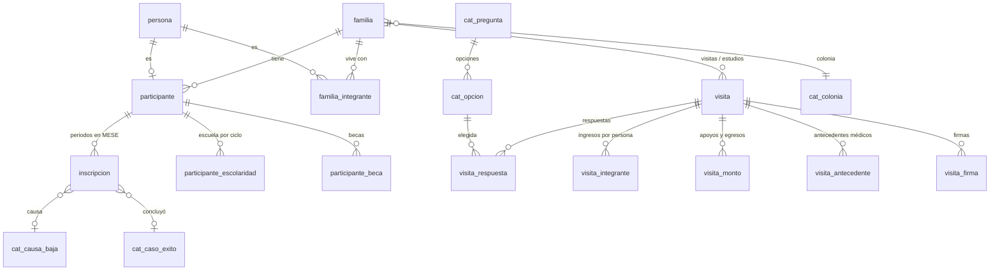

# Base de datos de MESE (MySQL)

Base de datos normalizada para todo lo que hoy vive en los Excel de MESE: participantes activos (hoja BASE), familiares e indirectos (BDI), bajas y base de datos histórica, más el cuestionario de seguimiento familiar que se llena en el celular.

Toda la lógica está en SQL: la aplicación (Java o la página web) solo hace `CALL sp_...` para escribir y `SELECT * FROM v_...` para leer.

## Archivos y orden de instalación

| Archivo | Qué hace |
|---|---|
| `01_esquema.sql` | Crea la base `mese`: 43 tablas con llaves, restricciones `CHECK`, `UNIQUE` e índices |
| `02_catalogos.sql` | Llena los catálogos: parentescos, niveles y grados, causas de baja, preguntas y opciones del cuestionario, rangos de edad de la hoja de estadísticas |
| `03_funciones_vistas.sql` | Funciones (`fn_edad`, `fn_ciclo`) y las vistas que lee la aplicación |
| `04_procedimientos.sql` | Altas, bajas, reactivaciones, edición, guardar visitas del teléfono y reportes |
| `05_triggers.sql` | Validaciones que dependen de la fecha de hoy o de otros renglones, y la bitácora de cambios |
| `06_carga_excel.sql` | Tablas de paso y procedimientos para pasar los Excel actuales a la base |
| `07_pruebas.sql` | 45 pruebas automáticas; al final muestra cuáles pasaron |
| `08_seguridad.sql` | Usuario de la aplicación con permisos mínimos (cambie las contraseñas) |

```bash
# MySQL 8.0.16 o superior, con un usuario administrador (root)
mysql -u root -p < 01_esquema.sql
mysql -u root -p < 02_catalogos.sql
mysql -u root -p < 03_funciones_vistas.sql
mysql -u root -p < 04_procedimientos.sql
mysql -u root -p < 05_triggers.sql
mysql -u root -p < 07_pruebas.sql      # opcional: debe decir 45 pasaron, 0 fallaron
mysql -u root -p < 08_seguridad.sql
```

Si MySQL tiene el registro binario activo (lo trae por omisión) y no instala con root, active antes `SET GLOBAL log_bin_trust_function_creators = 1;` para que acepte las funciones.

## Diagrama



## Cómo se normalizó

Los Excel tienen problemas típicos que la base elimina:

| En Excel | Problema | En la base |
|---|---|---|
| `HERMANO 1`, `HERMANO 2`… `ABUELA` (60 columnas en BDI) | Grupos repetidos (viola 1FN) | `familia_integrante`: una fila por familiar, con su parentesco |
| `REPSOL/BÉCALOS`, `CEMENTO/TIERRA`, `IMSS, SIMI` | Varios valores en una celda (viola 1FN) | `participante_beca`, `visita_respuesta`: una fila por valor |
| Datos de la casa repetidos en cada hermano | Dependen de la familia, no del niño (viola 2FN/3FN) | `familia` y `visita` guardan la casa una sola vez |
| Madre escrita en BASE y otra vez con su edad en BDI | La misma persona en dos lugares | `persona` una sola vez; madre, participante e indirecto son papeles |
| `EDAD`, `AÑOS DE PERMANENCIA`, `INGRESO TOTAL`, `INGRESO DIARIO POR INTEGRANTE` | Datos calculados que se desactualizan (la edad cambia cada año) | No se guardan: las vistas los calculan al momento |
| Hojas BASE, BAJAS e HISTÓRICA con columnas distintas | La misma información en tres formatos | Una sola tabla `inscripcion` con fecha de ingreso y, si salió, fecha y causa |
| `UNIÓN LIBRE`, `UNION LIBRE`, `UNIÓN LINRE` | Texto libre con variantes | Catálogos (`cat_*`) con llaves foráneas |

El cuestionario se guarda con un catálogo de preguntas y opciones (`cat_pregunta`, `cat_opcion`) en lugar de una columna por pregunta. Si MESE cambia el formato en papel, se agregan renglones y no hay que modificar tablas. La llave foránea compuesta `(opcion_id, pregunta_id)` impide guardar una opción que no pertenece a esa pregunta.

## Lo que la aplicación usa

**Vistas (lectura):** `v_activo`, `v_baja`, `v_historico`, `v_familiar`, `v_participante`, `v_visita_resumen`, `v_familia_actual`, `v_respuesta`.

**Procedimientos (escritura):** `sp_alta_participante`, `sp_actualizar_persona`, `sp_guardar_familiar`, `sp_guardar_escolaridad`, `sp_registrar_baja`, `sp_reactivar`, `sp_guardar_visita`, `sp_eliminar_visita`.

**Reportes:**
- `sp_estadisticas_mes(año, mes)` reproduce la hoja "ESTADÍSTICAS". Cuenta a quienes estaban activos el último día del mes, con la edad que tenían ese día, así que se puede sacar cualquier mes pasado.
- `sp_reporte_visitas(desde, hasta, trabajadora, colonia)` da el resumen y el conteo de cada respuesta.
- `sp_visitas_tabla(desde, hasta)` da una fila por visita y una columna por pregunta, para exportar.
- `sp_buscar(texto, límite)` busca sin importar acentos ni mayúsculas.

`sp_guardar_visita` recibe el mismo objeto que guarda la página en el teléfono (`{"id","est","mod","d":{...}}`). Si llega dos veces no se duplica, y si llega una copia más vieja no borra la más nueva.

### Desde Java

```java
try (Connection c = DriverManager.getConnection(url, "mese_app", pass)) {
    c.createStatement().execute("SET @usuario_id = " + idTrabajadora);   // para la bitácora

    // Leer
    ResultSet rs = c.createStatement().executeQuery("SELECT * FROM v_activo ORDER BY nombre_completo");

    // Escribir
    CallableStatement cs = c.prepareCall("{call sp_registrar_baja(?, ?, ?, ?, ?, ?)}");
    cs.setInt(1, personaId); cs.setDate(2, Date.valueOf(fecha));
    cs.setString(3, "Cambio de domicilio"); cs.setString(4, "Continúa estudiando");
    cs.setNull(5, Types.VARCHAR); cs.setString(6, motivo);
    cs.execute();
} catch (SQLException e) {
    if ("45000".equals(e.getSQLState())) mostrarAlUsuario(e.getMessage()); // mensajes ya escritos en español
}
```

## ¿La base debe hacerlo todo, incluso con triggers?

Sí conviene que la base sea la que garantiza las reglas, pero no todo debe ir en triggers. El orden que seguimos:

1. **Restricciones declarativas primero** (`NOT NULL`, `UNIQUE`, `CHECK`, llaves foráneas). Son rápidas, no se pueden saltar y no tienen errores de programación. Ejemplos: grado válido por nivel (`Secundaria 5°` no existe), CURP con formato correcto y una sola inscripción abierta por niño (con una columna generada y una llave única, sin trigger).
2. **Procedimientos para cada operación** (alta, baja, guardar visita). Agrupan varios pasos en una transacción y devuelven mensajes claros. Además, el usuario de la aplicación solo tiene permiso de ejecutarlos, así que nadie puede escribir saltándose las reglas.
3. **Triggers solo donde no hay otra forma.** Son 14: los que necesitan la fecha de hoy (no hay fechas futuras), los que comparan con otros renglones (periodos que se enciman, una sola respuesta en preguntas de respuesta única) y la bitácora de quién cambió qué.

No conviene poner toda la lógica en triggers porque:
- Actúan a escondidas, y cuando algo falla es difícil saber cuál se disparó.
- MySQL no permite apagarlos: aquí se usa `SET @importando = 1` para la carga masiva.
- Se ejecutan renglón por renglón, lo que hace lenta una carga grande.
- Cuesta más probarlos que un procedimiento.

Lo que sí debe repetir la aplicación son las validaciones de comodidad (avisar en el formulario antes de enviar). La base es la última línea de defensa, no la única.

## Pasar los Excel a la base

Ver las instrucciones al inicio de `06_carga_excel.sql`. En resumen:
1. Guardar cada hoja como CSV.
2. `LOAD DATA` a las tablas de paso.
3. `CALL sp_carga_todo('2026-09-30');`
4. Revisar `carga_pendiente`, donde aparecen los valores que no se reconocieron. Para corregirlos se agregan equivalencias en `cat_alias` y se repite la carga.

### Prueba con los archivos reales

Se cargaron `10. OCTUBRE.xlsx` (BASE), `8. BDI AGOSTO.xlsx` y la base histórica. Luego se comparó `CALL sp_estadisticas_mes(2026, 9)` con la hoja "ESTADÍSTICAS SEPTIEMBRE 2026" en papel:

| Dato | Hoja en papel | Base de datos |
|---|---|---|
| Participantes directos (F / M) | 67 / 73 = 140 | 67 / 73 = 140 |
| 6 a 12 · 13 a 18 · 19 a 25 (F) | 40 · 25 · 2 | 39 · 26 · 2 |
| Base de datos histórica | 1,267 | 1,267 |
| Casos de éxito | 469 | 469 |
| Secundaria · Oficio · Carrera téc. · C.T. c/bach · Prepa · Lic. | 299 · 37 · 30 · 25 · 51 · 27 | 299 · 37 · 30 · 25 · 51 · 27 |
| No concluyeron | 798 | 798 |
| Menores que han pasado por MESE | 1,407 | 1,407 |
| Primaria por grado (F y M) | igual | igual |
| Familias · Colonias | 97 · 36 | 100 · 38 |
| Indirectos | 146 | 141 |
| Tutores con edad | 157 | 146 (30 tutores sin fecha de nacimiento en BDI) |

Las diferencias pequeñas tienen explicación:
- **Una niña de 12 o 13 años:** depende del día exacto en que se calcula la edad.
- **Familias (100 contra 97):** se agrupan por el nombre de la madre o tutor.
- **Tutores e indirectos:** dependen de las edades capturadas en BDI.

De 1,407 registros, solo 29 quedaron para revisión, todos por datos que faltan en el Excel (por ejemplo, 9 registros históricos sin ninguna fecha).

Probado en MariaDB 11.4. MySQL no se podía instalar en el entorno de trabajo; se revisaron las diferencias con MySQL 8 y se evitaron (por ejemplo, leer dos veces la misma tabla temporal en una consulta).

## Preguntas para MESE

- **Hoja BAJAS de `10. OCTUBRE.xlsx`:** no tiene encabezados y su acomodo de columnas es distinto al de BASE. Falta confirmar qué es cada columna antes de cargarla.
- **¿Qué significa "SÁBANA FAMILIAS"** (APEGADA…)? Por ahora se guarda como nota de la visita.
- **¿Cómo cuentan las familias en la hoja de estadísticas?** Así se ajusta la regla para llegar a 97.
- **Género:** hoy solo admite F y M, como en la estadística. Si se necesita otra opción, es un cambio de una línea.
